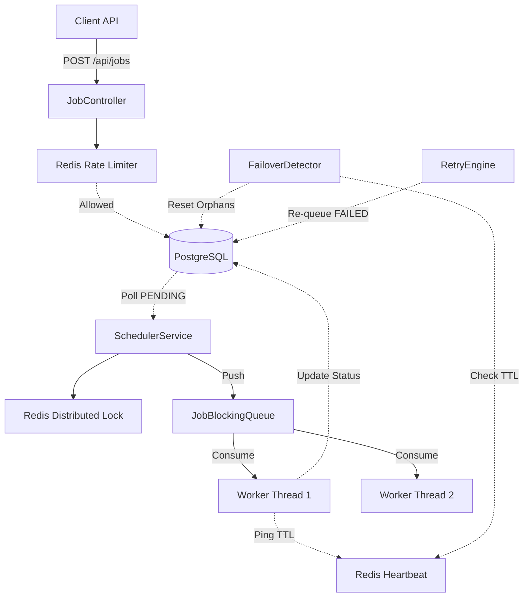

<h1 align="center">
  <br>
  🚀 OptiQueue
  <br>
</h1>

<h4 align="center">A high-performance, distributed Task Scheduling and Job Processing Engine built with Spring Boot, PostgreSQL, and Redis.</h4>

<p align="center">
  <a href="#key-features">Features</a> •
  <a href="#architecture">Architecture</a> •
  <a href="#prerequisites">Prerequisites</a> •
  <a href="#quick-start">Quick Start</a> •
  <a href="#api-reference">API Reference</a> •
  <a href="#deployment">Deployment</a>
</p>

---

## 🌟 Key Features

- **Robust Scheduling**: Custom Earliest Deadline First (EDF) scheduler with priority banding.
- **Distributed Reliability**: At-least-once delivery guarantee using PostgreSQL as the source of truth.
- **Worker Failover**: Automatic detection of dead workers via Redis heartbeats and recovery of orphaned jobs.
- **Advanced Retry Engine**: Exponential backoff with Full/Equal Jitter to prevent thundering herds, plus a Dead Letter Queue (DLQ).
- **Idempotency**: Safe re-submissions using `idempotency_key` with DB-level UNIQUE constraints to prevent TOCTOU race conditions.
- **Rate Limiting**: IP-based rate limiting using Redis atomic operations (INCR+EXPIRE).
- **Distributed Locks**: Ensures only one scheduler node polls the DB at a time (Split-brain prevention).
- **Production Ready**: Multi-stage Docker builds, Flyway schema migrations, and API Key authentication.
- **Fully Tested**: E2E Integration tests using Testcontainers (Real Postgres + Redis).

## 🏛 Architecture

OptiQueue separates the durable state (PostgreSQL) from the ephemeral state (Redis) and execution logic.



## 🛠 Prerequisites

- **Java 21** (If running locally without Docker)
- **Maven**
- **Docker & Docker Compose** (For running the full stack)

## 🚀 Quick Start

The easiest way to run OptiQueue is via Docker Compose, which spins up the application along with PostgreSQL and Redis.

```bash
# 1. Clone the repository
git clone https://github.com/Kaushtubha/optiqueue.git
cd optiqueue

# 2. Start the stack (App, Postgres 16, Redis 7)
docker compose up -d --build

# 3. Wait ~30 seconds for Flyway migrations to complete, then check health
curl http://localhost:8080/actuator/health
```

To run the full end-to-end verification suite:
```powershell
# Windows PowerShell
.\scripts\verify.ps1
```

## 📖 API Reference

OptiQueue exposes a RESTful API. Below are the core endpoints.

### Submit a Job
```bash
curl -X POST http://localhost:8080/api/jobs \
  -H "Content-Type: application/json" \
  -d '{
        "jobType": "EMAIL_SEND",
        "payload": "{\"to\":\"user@example.com\"}",
        "priority": 3,
        "idempotencyKey": "txn-987654321"
      }'
```
**Returns:** `201 Created` (or `200 OK` if the idempotency key already exists)

### Get Job Status
```bash
curl http://localhost:8080/api/jobs/550e8400-e29b-41d4-a716-446655440000
```
**Returns:** Job metadata including `status` (PENDING, IN_PROGRESS, COMPLETED, FAILED, RETRYING, CANCELLED, DEAD_LETTER).

### Cancel a Job
```bash
curl -X DELETE http://localhost:8080/api/jobs/550e8400-e29b-41d4-a716-446655440000
```

## ☁️ Deployment (Oracle Cloud ARM)

This project includes a CI/CD pipeline (GitHub Actions) configured to deploy automatically to an Oracle Cloud "Always Free" Ampere (arm64) VM.

To set up your VM:
1. Provision an Oracle Linux/Ubuntu ARM VM.
2. Open port `8080` in the OCI Security List.
3. Run the setup script on the VM:
```bash
chmod +x scripts/setup-oracle-vm.sh
./scripts/setup-oracle-vm.sh
```

## 🧪 Testing

OptiQueue uses **Testcontainers** for true integration testing. Docker must be running to execute the tests.

```bash
# Run all unit and integration tests
mvn test
```

## 🔐 Security

In production, OptiQueue uses API Key authentication.
Set the `API_KEYS` environment variable in your `.env` file (comma-separated for zero-downtime rotation). 
Clients must pass the key in the header:
```http
X-API-Key: your_secret_key_here
```

---
> Designed with ❤️ for distributed systems architecture and reliability.
