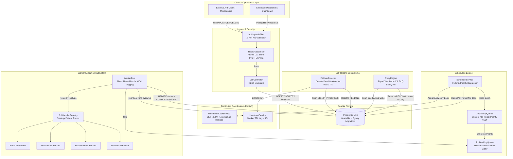
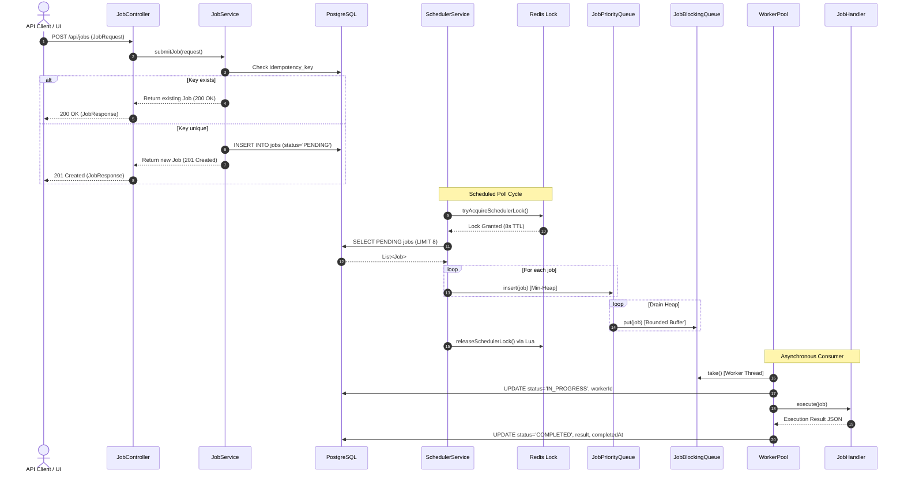
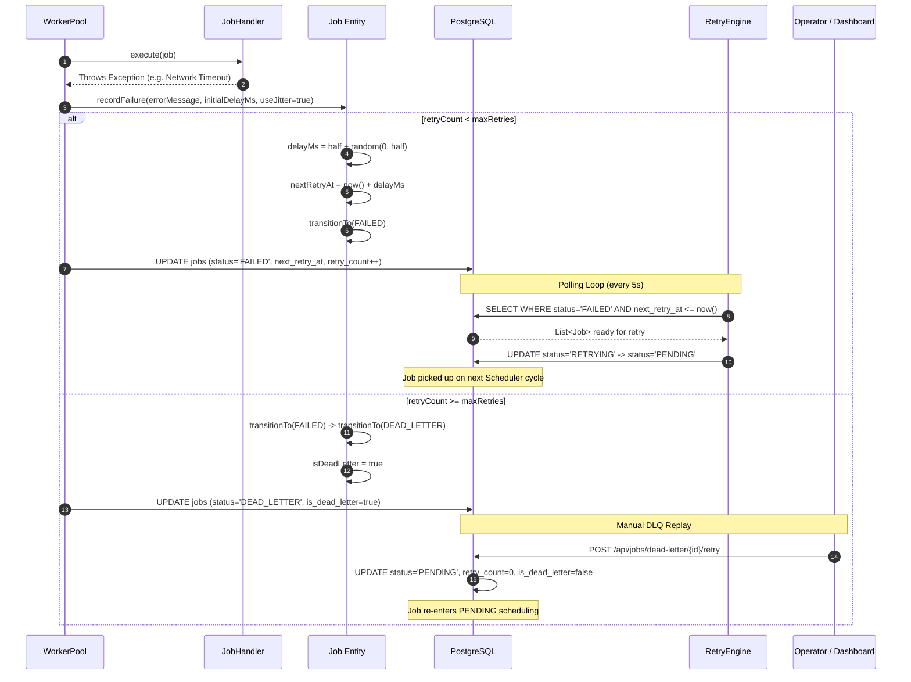
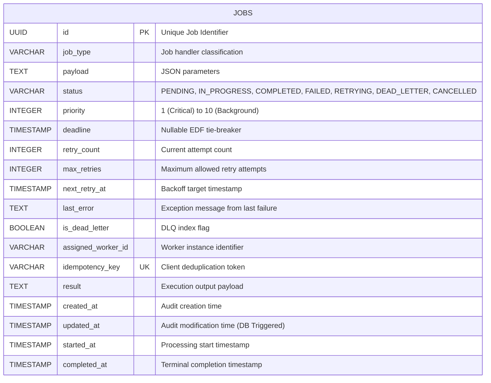

# OptiQueue

<p align="center">
  <strong>A resilient, distributed task scheduling and background job execution engine built with Java 21, Spring Boot 3, PostgreSQL, and Redis.</strong>
</p>

<p align="center">
  <a href="https://optiqueue.onrender.com">
    
  </a>
</p>

<p align="center">
  <a href="https://github.com/Kaushtubha/optiqueue/actions/workflows/ci-cd.yml">
    
  </a>
  <a href="https://github.com/Kaushtubha/optiqueue">
    
  </a>
  <a href="https://spring.io/projects/spring-boot">
    
  </a>
  <a href="https://www.postgresql.org/">
    
  </a>
  <a href="https://redis.io/">
    
  </a>
  <a href="https://www.docker.com/">
    
  </a>
</p>

> [!TIP]
> **🚀 Live Interactive Demo**: Visit **[https://optiqueue.onrender.com](https://optiqueue.onrender.com)** to explore the real-time operations dashboard. Click **`⚡ Launch Demo Workload`** to dispatch 10 real distributed tasks and watch workers process them live!


---

## Table of Contents

1. [Project Overview](#-1-project-overview)
2. [Problem Statement & Real-World Use Cases](#-2-problem-statement--real-world-use-cases)
3. [System Architecture](#-3-system-architecture)
4. [Embedded Operations Dashboard](#-4-embedded-operations-dashboard)
5. [Backend Architecture & Module Breakdown](#-5-backend-architecture--module-breakdown)
6. [Job Lifecycle & State Transitions](#-6-job-lifecycle--state-transitions)
7. [Data Architecture & Storage Model](#-7-data-architecture--storage-model)
8. [Core Reliability Mechanisms](#-8-core-reliability-mechanisms)
9. [Technology Stack & Justifications](#-9-technology-stack--justifications)
10. [REST API Reference](#-10-rest-api-reference)
11. [Local Setup & Running Instructions](#-11-local-setup--running-instructions)
12. [Testing Strategy & CI Pipeline](#-12-testing-strategy--ci-pipeline)
13. [Security Architecture](#-13-security-architecture)
14. [Deployment Guides](#-14-deployment-guides)
15. [Architectural Decisions & Engineering Trade-Offs](#-15-architectural-decisions--engineering-trade-offs)
16. [Known Limitations & Technical Roadmap](#-16-known-limitations--technical-roadmap)
17. [Repository Structure & Contributing](#-17-repository-structure--contributing)
18. [Author & Links](#-18-author--links)

---

## 📌 1. Project Overview

**OptiQueue** is an asynchronous job scheduling and execution platform engineered to bridge the gap between simple in-memory task queues and high-complexity message streaming brokers. It provides **durable persistence**, **strict priority scheduling**, **idempotent submissions**, and **automatic worker failure recovery** using a clean separation of concerns:

- **PostgreSQL** serves as the authoritative, durable source of truth for job lifecycle records and audit history.
- **Redis** provides low-latency coordination, handling worker heartbeats, advisory distributed locks, and atomic client rate limiting.
- **Spring Boot & Java 21** power a bounded producer-consumer thread pool with pluggable job execution handlers.

### Engineering Problems Solved
- **Guaranteed At-Least-Once Delivery**: Jobs are never stored solely in volatile memory; they are transactionally persisted before acknowledgment.
- **Orphaned Job Recovery**: Dead or crashed workers are automatically detected via expired Redis heartbeats, and their abandoned jobs are transparently re-queued.
- **Thundering Herd Prevention**: Failed tasks employ **exponential backoff with equal jitter** to avoid coordinated waves of retries that overwhelm downstream dependencies.
- **Advisory Distributed Coordination**: Background scheduler nodes use atomic Redis Lua scripts (`SET NX PX` and atomic token validation on release) to prevent duplicate execution across horizontal replicas.

---

## 🎯 2. Problem Statement & Real-World Use Cases

Modern web architectures must decouple long-running, latency-sensitive, or failure-prone tasks from synchronous HTTP request threads. Blocking an HTTP request while waiting for third-party services degrades client response latency, exhausts web container thread pools, and creates cascading outages.

```
Synchronous Failure Mode:
Client HTTP Request ──► [Web Server Thread Blocked] ──► [Slow 3rd-Party API] ──► 504 Gateway Timeout
                                                                             └──► Thread Pool Exhaustion

OptiQueue Asynchronous Mode:
Client HTTP Request ──► [OptiQueue API (201 Created)] ──► Client receives immediate Job UUID
                               │
                        PostgreSQL Persistence
                               │
                       [Scheduler Min-Heap]
                               │
                      [Worker Thread Pool] ──► [Pluggable Handler Execution] ──► Result Stored
```

### Supported Concrete Applications

1. **Transactional Email & Notification Dispatch (`EMAIL_SEND`)**:
   - *Scenario*: User registers or an invoice is generated.
   - *Handling*: Handed off to [`EmailJobHandler`](src/main/java/com/optiqueue/worker/handler/EmailJobHandler.java) with recipient metadata; executes asynchronously with realistic network latency simulation and stores unique delivery message IDs.
2. **Reliable Webhook Delivery (`WEBHOOK_DISPATCH`)**:
   - *Scenario*: Dispatched payment or fulfillment webhooks to external client endpoints.
   - *Handling*: Handled by [`WebhookJobHandler`](src/main/java/com/optiqueue/worker/handler/WebhookJobHandler.java) using Java 11+ `HttpClient` with connection timeouts and HTTP status validation.
3. **Asynchronous Report Calculation (`REPORT_GEN`)**:
   - *Scenario*: Large-scale end-of-month financial aggregations or CSV/PDF exports.
   - *Handling*: Processed by [`ReportGenJobHandler`](src/main/java/com/optiqueue/worker/handler/ReportGenJobHandler.java), simulating CPU-bound processing and persisting summary artifacts into the job record.
4. **Resilient Third-Party Retries**:
   - *Scenario*: Downstream APIs throw `503 Service Unavailable` or experience transient network timeouts.
   - *Handling*: Handled by [`RetryEngine`](src/main/java/com/optiqueue/retry/RetryEngine.java) and [`Job.recordFailure()`](src/main/java/com/optiqueue/domain/Job.java), applying jittered backoff and routing exhausted attempts to the Dead Letter Queue.
5. **Worker Crash Failover**:
   - *Scenario*: A containerized worker process experiences an OOM crash or network partition while processing an `IN_PROGRESS` job.
   - *Handling*: Handled by [`FailoverDetector`](src/main/java/com/optiqueue/failover/FailoverDetector.java), identifying expired Redis heartbeats and safely resetting orphaned tasks to `PENDING`.

---

## 🏛 3. System Architecture

The following diagram illustrates the component interactions, transactional boundaries, and coordination protocols across the OptiQueue system:



---

## 🖥 4. Embedded Operations Dashboard

OptiQueue includes a zero-dependency, real-time glassmorphism operations dashboard served directly by the embedded web container:

- **Live Cloud URL**: **[https://optiqueue.onrender.com/](https://optiqueue.onrender.com/)**
- **Local URL**: `http://localhost:8080/` (mapped to `src/main/resources/static/index.html`).
- **Frontend Architecture**: Written in semantic HTML5, CSS3 glassmorphism, and vanilla ES6+ JavaScript. Zero external NPM or framework overhead.
- **⚡ Instant Demo Workload**: One-click **`⚡ Launch Demo Workload`** button dispatches 10 real distributed jobs (`EMAIL_SEND`, `WEBHOOK_DISPATCH`, `REPORT_GEN`, and a DLQ retry test) to immediately demonstrate the worker cluster in action.
- **🔍 Interactive Job Inspector**: Click on any row in the activity table to open a detailed modal with the complete JSON input payload and actual execution result stored in PostgreSQL.
- **Live Metric Polling**: Automatically refreshes every 3 seconds via `/api/jobs/metrics`:
  - *Total Jobs Submitted*
  - *Pending Jobs (In Queue)*
  - *In-Progress (Active Workers)*
  - *Completed Jobs*
  - *Dead Letter Queue (DLQ)*
- **Dead Letter Queue Management**: Dedicated DLQ view with one-click **↻ Replay** calling `POST /api/jobs/dead-letter/{id}/retry`.
- **Cancellation Controls**: Instant cancellation of active or pending jobs directly from the activity feed.

```
┌────────────────────────────────────────────────────────────────────────────────────────┐
│  OptiQueue Operations Dashboard                                         ● Engine Live  │
├───────────────┬───────────────┬────────────────┬───────────────┬───────────────────────┤
│  TOTAL JOBS   │    PENDING    │  IN PROGRESS   │   COMPLETED   │      DEAD LETTER      │
│      128      │       2       │       4        │      120      │           2           │
├───────────────┴───────────────┴────────────────┴───────────────┴───────────────────────┤
│ [ Recent Activity ]  [ Dead Letter Queue (2) ]                   Auto-refreshing (3s)  │
├────────────────────────────────────────────────────────────────────────────────────────┤
│ JOB ID      TYPE              PRIORITY  STATUS       RETRIES  WORKER ID       ACTIONS  │
│ 8f4a1b...   EMAIL_SEND        P1        COMPLETED    0/5      worker-1        -        │
│ e2c90d...   WEBHOOK_DISPATCH  P3        IN_PROGRESS  1/5      worker-2        [Cancel] │
│ 3b7e4a...   REPORT_GEN        P5        DEAD_LETTER  5/5      worker-1        [Replay] │
└────────────────────────────────────────────────────────────────────────────────────────┘
```

---

## ⚙️ 5. Backend Architecture & Module Breakdown

OptiQueue follows a strict layered architecture with decoupled responsibilities across packages:

| Component / Class | Source File | Core Responsibility |
| :--- | :--- | :--- |
| **`JobController`** | [`JobController.java`](src/main/java/com/optiqueue/controller/JobController.java) | Exposes REST endpoints, validates inbound DTOs, enforces rate limits, maps HTTP status codes. |
| **`JobService`** | [`JobService.java`](src/main/java/com/optiqueue/service/JobService.java) | Encapsulates core business rules, transactional idempotency checks, and status validation. |
| **`Job` (Entity)** | [`Job.java`](src/main/java/com/optiqueue/domain/Job.java) | JPA entity mapping the `jobs` table with lifecycle transition guards and backoff calculations. |
| **`JobStatus`** | [`JobStatus.java`](src/main/java/com/optiqueue/domain/JobStatus.java) | State machine enum defining legal transitions (`PENDING`, `IN_PROGRESS`, `COMPLETED`, `FAILED`, `RETRYING`, `DEAD_LETTER`, `CANCELLED`). |
| **`JobRepository`** | [`JobRepository.java`](src/main/java/com/optiqueue/repository/JobRepository.java) | Spring Data JPA repository with indexed queries for scheduler batches, retry candidates, and failovers. |
| **`SchedulerService`** | [`SchedulerService.java`](src/main/java/com/optiqueue/scheduler/SchedulerService.java) | Producer component: polls database batches under Redis distributed locks and feeds the worker queue. |
| **`JobPriorityQueue`** | [`JobPriorityQueue.java`](src/main/java/com/optiqueue/scheduler/JobPriorityQueue.java) | Custom binary min-heap implementation ordering jobs by priority (1 to 10) and Earliest Deadline First (EDF). |
| **`JobBlockingQueue`** | [`JobBlockingQueue.java`](src/main/java/com/optiqueue/worker/JobBlockingQueue.java) | Thread-safe, bounded blocking buffer using `ReentrantLock` and `Condition` variables for worker handoff. |
| **`WorkerPool`** | [`WorkerPool.java`](src/main/java/com/optiqueue/worker/WorkerPool.java) | Consumer component: fixed pool of named daemon worker threads processing jobs with MDC context logging. |
| **`JobHandlerRegistry`** | [`JobHandlerRegistry.java`](src/main/java/com/optiqueue/worker/handler/JobHandlerRegistry.java) | Strategy-pattern dispatch router dynamically mapping job types to concrete `JobHandler` beans. |
| **`RetryEngine`** | [`RetryEngine.java`](src/main/java/com/optiqueue/retry/RetryEngine.java) | Asynchronous background scanner re-queuing failed jobs whose backoff delay has expired. |
| **`FailoverDetector`** | [`FailoverDetector.java`](src/main/java/com/optiqueue/failover/FailoverDetector.java) | Liveness monitor identifying dead workers via missing Redis TTLs and restoring abandoned jobs. |
| **`DistributedLockService`**| [`DistributedLockService.java`](src/main/java/com/optiqueue/redis/DistributedLockService.java) | Advisory locking using `SET NX PX` and atomic token validation on release via Redis Lua scripting. |
| **`RedisRateLimiter`** | [`RedisRateLimiter.java`](src/main/java/com/optiqueue/redis/RedisRateLimiter.java) | Fixed-window client IP rate limiting implemented via an atomic Redis Lua script. |
| **`ApiKeyAuthFilter`** | [`ApiKeyAuthFilter.java`](src/main/java/com/optiqueue/security/ApiKeyAuthFilter.java) | Stateless `OncePerRequestFilter` authenticating inbound `/api/**` traffic via `X-API-Key`. |
| **`GlobalExceptionHandler`**| [`GlobalExceptionHandler.java`](src/main/java/com/optiqueue/controller/GlobalExceptionHandler.java) | Centralized `@RestControllerAdvice` converting validation failures and server exceptions into RFC-compliant JSON. |

---

## 🔄 6. Job Lifecycle & Sequence Diagrams

### Normal Execution Sequence Flow
The following sequence depicts the end-to-end processing of a successfully submitted job:



### Failure, Exponential Backoff & Dead-Letter Sequence Flow
The following sequence depicts error handling, jitter calculation, and dead-letter queue routing:



---

## 🗄 7. Data Architecture & Storage Model

OptiQueue clearly delineates between durable relational data and ephemeral coordination data.

### PostgreSQL Schema & Indexes

PostgreSQL is managed through **Flyway migrations** ([`V1__create_jobs_table.sql`](src/main/resources/db/migration/V1__create_jobs_table.sql)):



#### Partial Indexes for Query Optimization
To maintain $O(\log N)$ and index-scan performance on high-volume tables, OptiQueue employs **PostgreSQL partial indexes**:
1. `idx_jobs_status_priority`: `ON jobs (status, priority, deadline) WHERE status = 'PENDING'`  
   *Targeted Query*: Scheduler batch poll queries only active unworked jobs, ignoring millions of historical completed jobs.
2. `idx_jobs_worker_status`: `ON jobs (assigned_worker_id, status) WHERE status = 'IN_PROGRESS'`  
   *Targeted Query*: Failover detector looks up orphan jobs matching dead worker IDs.
3. `idx_jobs_dead_letter`: `ON jobs (is_dead_letter, created_at) WHERE is_dead_letter = TRUE`  
   *Targeted Query*: Fast dashboard retrieval for the Dead Letter Queue manager.
4. `trg_jobs_updated_at`: Database trigger executing `BEFORE UPDATE` to guarantee `updated_at` accuracy even on raw SQL updates.

### Redis Key Design

| Key Pattern | Data Structure | TTL | Purpose |
| :--- | :--- | :--- | :--- |
| `optiqueue:scheduler:lock` | String (`holderId`) | 8,000 ms | Advisory distributed lock ensuring single-node scheduler execution. |
| `optiqueue:heartbeat:{workerId}` | String (timestamp) | 15,000 ms | Worker liveness beacon refreshed every 5,000 ms. Auto-expires on worker crash. |
| `rate:{clientIp}:{window}` | String (counter) | 60 s | Fixed-window request counter enforced by atomic Lua scripting. |

---

## 🛡 8. Core Reliability Mechanisms

| Mechanism | Engineering Challenge | How OptiQueue Implements It | Source Location |
| :--- | :--- | :--- | :--- |
| **Atomic Distributed Locking** | TOCTOU race conditions where a slow node deletes a newly acquired lock belonging to another node. | Evaluates token ownership inside an atomic Redis Lua script before executing `DEL`. | [`DistributedLockService.java`](src/main/java/com/optiqueue/redis/DistributedLockService.java) |
| **Atomic Rate Limiter** | Client node crash between `INCR` and `EXPIRE` creates permanent unexpired keys in Redis. | Bundles `INCR` and conditional `EXPIRE` into a single atomic Redis Lua script. | [`RedisRateLimiter.java`](src/main/java/com/optiqueue/redis/RedisRateLimiter.java) |
| **Worker Failover Recovery** | Worker container crashes mid-execution; job remains stuck in `IN_PROGRESS` indefinitely. | `FailoverDetector` runs every 30s. If `startedAt > 15s` and Redis key is missing, resets job to `PENDING`. | [`FailoverDetector.java`](src/main/java/com/optiqueue/failover/FailoverDetector.java) |
| **Equal Jitter Backoff** | Synchronized retries cause a "thundering herd" spike against recovering downstream services. | Backoff calculates `delay = half + random(0, half)` where `half = (initialDelay * 2^(attempt-1)) / 2`. | [`RetryEngine.java`](src/main/java/com/optiqueue/retry/RetryEngine.java) |
| **Strict Idempotency** | Duplicate submissions create duplicate processing of financial or notification events. | Checked via `@Transactional` read and enforced by database-level `UNIQUE (idempotency_key)` constraint. | [`JobService.java`](src/main/java/com/optiqueue/service/JobService.java) |
| **Backpressure Control** | Scheduler flooding memory with thousands of jobs faster than workers can process. | Two-stage architecture: Priority min-heap drains into a bounded `JobBlockingQueue` (capacity: 100). | [`JobBlockingQueue.java`](src/main/java/com/optiqueue/worker/JobBlockingQueue.java) |

---

## 💻 9. Technology Stack & Justifications

- **Java 21 (LTS)**: Utilizes modern language capabilities (Records, Pattern Matching, Text Blocks) and standard library performance.
- **Spring Boot 3.2.4**: Enterprise-grade dependency injection, declarative transactions (`@Transactional`), and Spring MVC for REST controllers.
- **PostgreSQL 16**: Relational ACID storage engine providing transactional integrity, partial indexes, and unique constraints.
- **Redis 7**: Single-threaded in-memory key-value store used for sub-millisecond atomic locking, rate-limiting, and key expiration TTLs.
- **Flyway**: Automated database schema version control ensuring migrations run identically across development, CI, and production.
- **Testcontainers 1.19.7**: Production-parity integration testing spinning up real PostgreSQL and Redis containers in Docker during JUnit runs.
- **Docker & Docker Compose**: Multi-stage build images with Alpine Linux runtime for minimal image footprint (~250MB) and non-root execution.
- **GitHub Actions**: Automated CI/CD pipeline building, testing, and publishing multi-architecture images (`amd64`, `arm64`) to GitHub Packages.

---

## 📡 10. REST API Reference

All `/api/**` endpoints require authentication via the `X-API-Key` header when `API_KEYS` is configured.

| Method | Endpoint | Description | Auth Required | Success Response | Errors |
| :--- | :--- | :--- | :--- | :--- | :--- |
| `POST` | `/api/jobs` | Submit a new background job | Yes | `201 Created` / `200 OK` | `400`, `401`, `429` |
| `POST` | `/api/jobs/demo-batch` | Dispatch 10 realistic jobs for instant cluster evaluation | Public / UI | `200 OK` | `500` |
| `GET` | `/api/jobs/{id}` | Retrieve job details and status | Yes | `200 OK` | `401`, `404` |
| `GET` | `/api/jobs/{id}/result`| Retrieve completed execution output | Yes | `200 OK` / `204 No Content` | `401`, `404` |
| `DELETE`| `/api/jobs/{id}` | Cancel pending or queued job | Yes | `200 OK` | `401`, `404`, `409` |
| `GET` | `/api/jobs` | Query jobs by `status` or `idempotencyKey` | Yes | `200 OK` | `401`, `404` |
| `GET` | `/api/jobs/recent` | Retrieve 50 latest jobs for feed | Public / UI | `200 OK` | - |
| `GET` | `/api/jobs/metrics`| Retrieve real-time queue breakdown | Public / UI | `200 OK` | - |
| `GET` | `/api/jobs/dead-letter` | List all dead-lettered jobs | Public / UI | `200 OK` | - |
| `POST` | `/api/jobs/dead-letter/{id}/retry` | Replay dead-letter job to `PENDING` | Yes | `200 OK` | `401`, `404` |
| `GET` | `/actuator/health` | Container and database health probe | **No** (Public) | `200 OK` | `503` |

### Concrete cURL Examples

#### 1. Dispatch Real Demo Batch (Live Cloud or Local)
```bash
# Against Live Cloud:
curl -X POST https://optiqueue.onrender.com/api/jobs/demo-batch

# Against Localhost:
curl -X POST http://localhost:8080/api/jobs/demo-batch
```

#### 2. Submit a Custom Job
```bash
curl -X POST https://optiqueue.onrender.com/api/jobs \
  -H "Content-Type: application/json" \
  -H "X-API-Key: optiqueue-portfolio-key-2026" \
  -d '{
    "jobType": "EMAIL_SEND",
    "payload": "{\"to\":\"user@example.com\",\"subject\":\"Welcome to OptiQueue\"}",
    "priority": 1,
    "idempotencyKey": "order-reg-98234"
  }'
```

#### 3. Query Real-Time Queue Metrics
```bash
curl https://optiqueue.onrender.com/api/jobs/metrics
```

*Response*:
```json
{
  "pending": 2,
  "inProgress": 1,
  "completed": 45,
  "failed": 0,
  "deadLetter": 1,
  "cancelled": 0,
  "total": 49
}
```

#### 3. Replay a Dead Letter Queue Job
```bash
curl -X POST http://localhost:8080/api/jobs/dead-letter/8f4a1b22-0000-4000-8000-000000000000/retry \
  -H "X-API-Key: test-api-key"
```

---

## 🚀 11. Local Setup & Running Instructions

### Prerequisites
- **Git**
- **Java 21 (LTS)**
- **Docker & Docker Compose** (Recommended for local orchestration)

### Option A: Complete Docker Compose Stack (Recommended)
This starts PostgreSQL 16, Redis 7, and OptiQueue with configured healthchecks:

```bash
# 1. Clone the repository
git clone https://github.com/Kaushtubha/optiqueue.git
cd optiqueue

# 2. Start the stack in background
docker compose up -d --build

# 3. Verify container health
docker compose ps
```
Once healthy, open `http://localhost:8080/` in your browser to access the dashboard.

### Option B: Local Standalone Execution (Java & Maven)
If running against existing local PostgreSQL and Redis instances:

```bash
# 1. Set environment variables
# On Linux/macOS:
export DB_URL="jdbc:postgresql://localhost:5432/optiqueue"
export DB_USER="optiqueue"
export DB_PASS="optiqueue"
export REDIS_HOST="localhost"
export REDIS_PORT="6379"

# On Windows PowerShell:
$env:DB_URL="jdbc:postgresql://localhost:5432/optiqueue"
$env:DB_USER="optiqueue"
$env:DB_PASS="optiqueue"
$env:REDIS_HOST="localhost"
$env:REDIS_PORT="6379"

# 2. Run application using Maven Wrapper
# Linux/macOS:
./mvnw spring-boot:run

# Windows PowerShell:
.\mvnw.cmd spring-boot:run
```

---

## 🧪 12. Testing Strategy & CI Pipeline

OptiQueue maintains a comprehensive automated testing suite:

```
Testing Architecture:
├── Unit Tests (38 Tests, Zero External Dependencies, Mockito + In-Memory Assertions)
│   ├── FailoverDetectorTest (3 tests)   ── Worker heartbeat expiration & job recovery
│   ├── RetryEngineTest (11 tests)       ── Backoff exponential growth & equal jitter math
│   ├── JobPriorityQueueTest (10 tests)  ── Binary min-heap ordering & EDF tie-breaking
│   ├── IdempotencyTest (7 tests)        ── Deduplication & transactional safety
│   └── JobBlockingQueueTest (7 tests)   ── Bounded buffer concurrency & thread handoff
└── Integration Tests (Testcontainers + Docker)
    └── JobApiIntegrationTest            ── Real Postgres 16 & Redis 7 container lifecycles
```

### Running the Tests Locally

#### Run Unit Tests (Fast, no Docker required):
```bash
# Linux/macOS:
./mvnw test -DexcludedGroups=integration

# Windows:
.\mvnw.cmd test -DexcludedGroups=integration
```
*Current Result*: **38 Passed, 0 Failed, 0 Skipped** (Execution time: ~10 seconds).

#### Run Full Integration Tests (Requires local Docker daemon):
```bash
./mvnw test -Dtest=JobApiIntegrationTest
```

### GitHub Actions CI/CD Pipeline
Every push to `main` executes [`.github/workflows/ci-cd.yml`](.github/workflows/ci-cd.yml):
1. **Unit Tests**: Executed on Java 21 Temurin.
2. **Integration Tests**: Executed against ephemeral Testcontainers (Postgres & Redis).
3. **Multi-Arch Docker Build**: Packages and pushes `linux/amd64` and `linux/arm64` images to GitHub Container Registry (`ghcr.io/kaush/optiqueue`).
4. **Conditional Deployment**: Deploys to Oracle Cloud ARM VM when credentials are configured.

*Latest Verified Run*: [Workflow Run #40081435378](https://github.com/Kaushtubha/optiqueue/actions/runs/40081435378) — **Conclusion: SUCCESS**.

---

## 🔒 13. Security Architecture

1. **Stateless API Key Authentication**:
   - Implemented via [`ApiKeyAuthFilter`](src/main/java/com/optiqueue/security/ApiKeyAuthFilter.java).
   - Enforces valid `X-API-Key` headers on `/api/**` paths while keeping public health probes (`/actuator/health`) accessible to load balancers.
   - Supports comma-separated keys (`API_KEYS=key1,key2`) for zero-downtime key rotation.
2. **DDoS & Abuse Mitigation**:
   - Client IP rate-limiting enforced by [`RedisRateLimiter`](src/main/java/com/optiqueue/redis/RedisRateLimiter.java) using an atomic Lua script.
3. **Secret Hygiene**:
   - Real passwords and `.env` files are excluded by [`.gitignore`](.gitignore).
   - Only dummy placeholders exist in [`.env.example`](.env.example).
4. **Container Hardening**:
   - [`Dockerfile`](Dockerfile) runs as non-root user `optiqueue:optiqueue` to mitigate container escape vulnerabilities (CWE-250).

---

## ☁️ 14. Deployment Guides

### Option A: Verified Zero-Cost Cloud Deployment (Live)
OptiQueue is actively deployed live on a 100% free, zero-card architecture:
- **Live URL**: **[https://optiqueue.onrender.com](https://optiqueue.onrender.com)**
- **Web App**: Render Free Web Service running the multi-stage Docker container.
- **PostgreSQL**: [Neon.tech](https://neon.tech) Serverless PostgreSQL 16 (0.5 GB durable storage, free forever).
- **Redis**: [Upstash.com](https://upstash.com) Serverless Redis 8.4 with SSL (10,000 commands/day, free forever).
- **Total Hosting Cost**: **$0.00 / month** (Guaranteed zero unexpected charges).

### Option B: Oracle Cloud "Always Free" Ampere ARM VM
Oracle Cloud provides an Always Free Ampere ARM architecture (4 OCPU, 24 GB RAM):
1. Provision an Ubuntu 22.04 aarch64 Compute instance in OCI.
2. Open port `8080` in your VCN Ingress Rules.
3. SSH into the instance and run the initialization script:
   ```bash
   git clone https://github.com/Kaushtubha/optiqueue.git
   cd optiqueue
   chmod +x scripts/setup-oracle-vm.sh
   ./scripts/setup-oracle-vm.sh
   ```
4. Set GitHub repository secrets (`ORACLE_VM_IP`, `ORACLE_VM_USER`, `ORACLE_SSH_KEY`) to enable automated CD deployment on push.

---

## ⚖️ 15. Architectural Decisions & Engineering Trade-Offs

### 1. PostgreSQL as Primary Queue vs Dedicated Message Broker (RabbitMQ / Kafka)
- **Problem**: Need reliable task persistence with auditability and transactional deduplication.
- **Chosen Approach**: Persist job states in PostgreSQL, leveraging ACID transactions and unique constraints.
- **Benefit**: Zero message loss across cold restarts, simple operational footprint without maintaining a cluster of Kafka brokers or Zookeeper, and complete visibility via standard SQL queries.
- **Trade-off / Limitation**: Lower peak ingestion throughput compared to pure in-memory streaming brokers. Table index bloat requires proactive maintenance at high volumes.

### 2. Atomic Redis Lua Scripts vs Multi-Step Client Calls
- **Problem**: Time-of-Check to Time-of-Use (TOCTOU) race conditions during lock release and unexpired key leaks during process crashes.
- **Chosen Approach**: Execute lock release checks and rate-limit counter expiration inside single atomic Lua scripts.
- **Benefit**: Guarantees atomic execution inside Redis's single-threaded event loop with zero network round-trip race gaps.
- **Trade-off / Limitation**: Moves minor business logic into Redis script strings.

### 3. Custom Min-Heap + Bounded Blocking Queue vs Direct Thread Handoff
- **Problem**: Batch database reads return jobs out of priority order; pushing unbounded jobs into worker memory causes Out-Of-Memory (OOM) crashes.
- **Chosen Approach**: Two-stage in-memory architecture: a custom binary min-heap sorts jobs by priority + Earliest Deadline First (EDF), draining into a bounded `ArrayBlockingQueue`.
- **Benefit**: Strict priority scheduling guarantees and built-in backpressure preventing scheduler from overwhelming worker threads.
- **Trade-off / Limitation**: Requires custom memory structures; bounded queue size limits in-memory buffering capacity.

### 4. Exponential Backoff with Equal Jitter vs Fixed Delay
- **Problem**: Simultaneous failure of many tasks leads to synchronized retry storms ("thundering herd").
- **Chosen Approach**: Equal jitter calculation: `half + random(0, half)`.
- **Benefit**: Smooths retry spikes across the time window while guaranteeing a minimum backoff duration.
- **Trade-off / Limitation**: Individual task execution time becomes slightly non-deterministic.

---

## ⚠️ 16. Known Limitations & Technical Roadmap

### Current Limitations
- **Single-Node Database Polling**: Scheduled polling of a single PostgreSQL table can become an I/O bottleneck above tens of thousands of concurrent jobs per second without database table partitioning.
- **Single-Instance Redis Advisory Lock**: The distributed lock utilizes single-node `SET NX PX`. While sufficient for scheduler coordination, it does not implement full distributed consensus (Redlock) across independent Redis clusters.

### Roadmap
- [ ] **Redis Sorted Set (ZSET) Delayed Queue**: Offload delayed retry jobs into a Redis sorted set with timestamp scores to reduce database polling frequency.
- [ ] **OpenTelemetry & Prometheus Metrics**: Add Prometheus metric scraping endpoints for worker thread pool utilization and queue latency histograms.
- [ ] **Partitioned Postgres Tables**: Add monthly partitioning to the `jobs` table to maintain index performance across millions of historical completed jobs.

---

## 📂 17. Repository Structure & Contributing

```
optiqueue/
├── .github/workflows/          # GitHub Actions CI/CD workflows
│   └── ci-cd.yml
├── scripts/                    # Infrastructure and deployment automation
│   ├── setup-oracle-vm.sh
│   └── verify.ps1
├── src/
│   ├── main/
│   │   ├── java/com/optiqueue/
│   │   │   ├── config/         # Properties and configuration binding
│   │   │   ├── controller/     # REST controllers, DTOs, global exception handler
│   │   │   ├── domain/         # Job entity, JobStatus state machine
│   │   │   ├── failover/       # FailoverDetector for dead worker recovery
│   │   │   ├── redis/          # DistributedLockService, RateLimiter, HeartbeatService
│   │   │   ├── repository/     # Spring Data JPA JobRepository
│   │   │   ├── retry/          # RetryEngine and jitter backoff logic
│   │   │   ├── scheduler/      # SchedulerService, JobPriorityQueue (min-heap)
│   │   │   ├── security/       # ApiKeyAuthFilter
│   │   │   ├── service/        # JobService business logic
│   │   │   └── worker/         # WorkerPool, JobBlockingQueue, JobHandlers
│   │   └── resources/
│   │       ├── db/migration/   # Flyway SQL migrations (V1__create_jobs_table.sql)
│   │       ├── static/         # Embedded Operations Dashboard (index.html)
│   │       └── application.yml # Core configuration
│   └── test/                   # Comprehensive unit and integration test suite
│       └── java/com/optiqueue/
├── docker-compose.yml          # Local multi-container development stack
├── Dockerfile                  # Multi-stage container build
├── render.yaml                 # 1-Click Render Cloud deployment blueprint
└── pom.xml                     # Maven project descriptor
```

### Contribution Workflow
1. Fork the repository.
2. Create a feature branch: `git checkout -b feature/your-feature-name`.
3. Verify all unit tests pass: `./mvnw test -DexcludedGroups=integration`.
4. Commit your changes with conventional commit messages: `git commit -m 'feat: add custom job handler'`.
5. Push to your branch and submit a Pull Request.

---

## 👤 18. Author & Links

Developed by **Kaushtubham Shukla** as an advanced engineering demonstration of distributed systems reliability, resilient scheduling, and production-grade backend architecture.

- **Live Demo**: [https://optiqueue.onrender.com](https://optiqueue.onrender.com)
- **Health Check**: [https://optiqueue.onrender.com/actuator/health](https://optiqueue.onrender.com/actuator/health)
- **GitHub**: [@Kaushtubha](https://github.com/Kaushtubha)
- **Repository**: [https://github.com/Kaushtubha/optiqueue](https://github.com/Kaushtubha/optiqueue)
