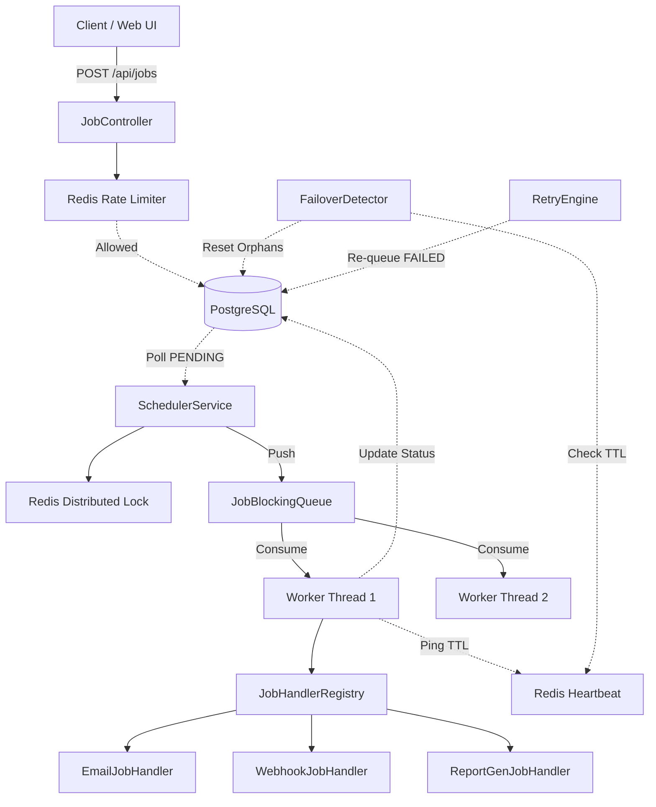

<h1 align="center">
  <br>
  🚀 OptiQueue
  <br>
</h1>

<h4 align="center">A high-performance, distributed Task Scheduling and Job Processing Engine built with Spring Boot, PostgreSQL, and Redis.</h4>

<p align="center">
  <a href="#key-features">Features</a> •
  <a href="#web-dashboard">Web Dashboard</a> •
  <a href="#architecture">Architecture</a> •
  <a href="#quick-start">Quick Start</a> •
  <a href="#free-deployment">100% Free Deployment</a> •
  <a href="#api-reference">API Reference</a> •
  <a href="#security">Security</a>
</p>

---

## 🌟 Key Features

- **Robust Scheduling**: Custom Earliest Deadline First (EDF) scheduler with priority banding (1=Urgent to 5=Normal).
- **Distributed Reliability**: At-least-once delivery guarantee using PostgreSQL as the durable source of truth.
- **Worker Failover**: Automatic detection of dead workers via Redis heartbeats and recovery of orphaned jobs.
- **Advanced Retry Engine**: Exponential backoff with Full/Equal Jitter to prevent thundering herds, plus Dead Letter Queue (DLQ) isolation.
- **DLQ Replay**: One-click REST and UI re-queueing of failed dead-letter jobs.
- **Pluggable Job Handlers**: Strategy-pattern registry supporting real job execution (`EMAIL_SEND`, `WEBHOOK_DISPATCH`, `REPORT_GEN`, and extensible handlers).
- **Web Operations Dashboard**: Glassmorphism real-time UI showing live queue metrics, worker heartbeat statuses, and direct job submission.
- **Idempotency**: Safe re-submissions using `idempotency_key` with DB-level `UNIQUE` constraints to prevent race conditions.
- **Rate Limiting**: IP-based rate limiting using Redis atomic operations (`INCR` + `EXPIRE`).
- **Distributed Locks**: Advisory Redis locks (`SET NX PX`) preventing split-brain polling across multiple scheduler nodes.
- **Production Ready**: Multi-stage Docker builds, Flyway schema migrations, and API Key authentication.
- **Fully Tested**: E2E Integration tests using Testcontainers (Real Postgres + Redis).

---

## 🖥️ Web Dashboard

OptiQueue comes with an embedded, zero-dependency, real-time glassmorphism web dashboard.

- **URL**: `http://localhost:8080/` (or `/index.html`)
- **Features**:
  - Live KPI cards: Total Jobs, Pending (EDF Queue), In-Progress Workers, Completed, and DLQ.
  - Interactive **Job Submission Modal** with JSON templates for Email, Webhooks, and Reports.
  - Live Activity Feed with auto-polling every 3 seconds.
  - **Dead Letter Queue (DLQ) Manager** with one-click **Replay / Retry**.
  - Immediate job cancellation.

---

## 🏛 Architecture

OptiQueue separates durable state (PostgreSQL) from ephemeral coordination (Redis) and worker execution logic.



---

## 🛠 Prerequisites

- **Java 21** (If running locally without Docker)
- **Maven**
- **Docker & Docker Compose** (For running the full stack)

---

## 🚀 Quick Start

The easiest way to run OptiQueue is via Docker Compose, which spins up the application along with PostgreSQL and Redis.

```bash
# 1. Clone the repository
git clone https://github.com/Kaushtubha/optiqueue.git
cd optiqueue

# 2. Start the stack (App, Postgres 16, Redis 7)
docker compose up -d --build

# 3. Open the Web Dashboard in your browser!
# http://localhost:8080/

# 4. Check API health
curl http://localhost:8080/actuator/health
```

To run the full end-to-end verification script:
```powershell
# Windows PowerShell
.\scripts\verify.ps1
```

---

## ☁️ 100% Free Deployment Guide

You can deploy OptiQueue completely free using either of the following methods:

### Option A: Render.com (1-Click Blueprint — Recommended)
OptiQueue includes a ready-to-deploy [`render.yaml`](render.yaml) blueprint:
1. Fork or push this repository to your GitHub account (`Kaushtubha/optiqueue`).
2. Log into [Render.com](https://render.com) (Free Tier).
3. Click **New +** $\rightarrow$ **Blueprints**.
4. Select your `optiqueue` repository.
5. Render will automatically provision:
   - Free Web Service (Docker)
   - Free Managed PostgreSQL Database
   - Free Managed Redis
6. Access your public OptiQueue dashboard and API at `https://optiqueue-app.onrender.com`!

### Option B: Oracle Cloud "Always Free" Ampere ARM VM
Oracle Cloud provides **4 OCPU cores, 24 GB RAM, and 200 GB NVMe storage 100% free forever**:
1. Provision an "Always Free" Ubuntu/Oracle Linux Ampere (aarch64) VM.
2. Allow ingress port `8080` in your VCN Security List.
3. SSH into the VM and run the automated setup script:
   ```bash
   git clone https://github.com/Kaushtubha/optiqueue.git
   cd optiqueue
   chmod +x scripts/setup-oracle-vm.sh
   ./scripts/setup-oracle-vm.sh
   ```
4. The GitHub Actions CI/CD workflow (`.github/workflows/ci-cd.yml`) will automatically build multi-arch images and deploy to your free VM on every push to `main`!

---

## 📖 API Reference

OptiQueue exposes a RESTful API:

### 1. Submit a Job
```bash
curl -X POST http://localhost:8080/api/jobs \
  -H "Content-Type: application/json" \
  -d '{
        "jobType": "EMAIL_SEND",
        "payload": "{\"to\":\"user@example.com\",\"subject\":\"Welcome\"}",
        "priority": 1,
        "idempotencyKey": "txn-unique-12345"
      }'
```

### 2. Live Queue Metrics
```bash
curl http://localhost:8080/api/jobs/metrics
```
**Returns:**
```json
{
  "pending": 2,
  "inProgress": 1,
  "completed": 45,
  "failed": 0,
  "deadLetter": 1,
  "cancelled": 0,
  "total": 49
}
```

### 3. Re-queue Dead Letter Queue (DLQ) Job
```bash
curl -X POST http://localhost:8080/api/jobs/dead-letter/{jobId}/retry
```

### 4. Get Job Status & Result
```bash
curl http://localhost:8080/api/jobs/{jobId}
curl http://localhost:8080/api/jobs/{jobId}/result
```

### 5. Cancel a Job
```bash
curl -X DELETE http://localhost:8080/api/jobs/{jobId}
```

---

## 🧪 Running Tests

OptiQueue comes with comprehensive test coverage separating unit tests and full integration tests:

### 1. Run Unit Tests (No external Docker required)
Executes all priority queue heaps, blocking queues, retry engine jitter math, idempotency, and failover detector unit tests:
```bash
./mvnw test -DexcludedGroups=integration
# or on Windows:
.\mvnw.cmd test -DexcludedGroups=integration
```

### 2. Run Full Integration Tests (Testcontainers)
Spins up real, ephemeral PostgreSQL 15 and Redis 7 containers via Testcontainers to verify end-to-end Flyway migrations, API persistence, and concurrent job lifecycles:
```bash
./mvnw test -Dtest=JobApiIntegrationTest
```
*(Requires a running Docker daemon on the host or runs automatically in the GitHub Actions Ubuntu CI pipeline).*

---

## ⚖️ Key Design Decisions & Trade-offs

1. **PostgreSQL as the Durable Source of Truth vs Pure In-Memory Queue (RabbitMQ / Kafka):**
   - *Decision:* Persist jobs and their state transitions in PostgreSQL, utilizing Redis purely for fast ephemeral operations (distributed locks, rate limiting, and heartbeats).
   - *Trade-off:* Slightly lower raw throughput compared to a pure in-memory broker, but provides full ACID persistence, transactional idempotency guarantees, complex state inspection, auditability, and zero risk of job loss across restarts.

2. **Atomic Lua Scripts in Redis vs Multi-Step Client Calls:**
   - *Decision:* Implemented distributed lock release and fixed-window rate-limiting via atomic Redis Lua scripts (`redis.call`).
   - *Trade-off:* Shifted minor execution logic into the Redis engine to completely eliminate Time-of-Check to Time-of-Use (TOCTOU) race conditions and ensure keys are never left without an expiry during abrupt process crashes.

3. **Earliest Deadline First (EDF) Min-Heap + Bounded Blocking Queue:**
   - *Decision:* Two-stage in-memory architecture: a priority min-heap sorts batched DB jobs by urgency and deadline, draining into a bounded `ArrayBlockingQueue` consumed by the worker thread pool.
   - *Trade-off:* Decouples batch database retrieval from thread execution, preventing the scheduler from flooding worker memory while ensuring critical priority jobs preempt lower priority ones.

4. **Equal Jitter Backoff vs Fixed Backoff:**
   - *Decision:* Added equal jitter (`half + random(0, half)`) to exponential backoff delays.
   - *Trade-off:* Individual retry delays become slightly non-deterministic, but completely prevents the "thundering herd" problem where hundreds of retrying jobs simultaneously overwhelm downstream services after an outage.

5. **Worker Heartbeat TTLs vs Active Database Polling:**
   - *Decision:* Workers refresh Redis key TTLs every 5 seconds. Failover detector checks key presence rather than querying an updated DB timestamp.
   - *Trade-off:* Requires Redis availability for worker health tracking, but offloads high-frequency health write traffic away from the PostgreSQL database engine.

---

## ⚠️ Known Limitations

- **Single-Node DB Contention at Ultra-High Scale:** High-frequency polling on a single relational DB table can cause lock contention if scaled to tens of thousands of concurrent jobs per second without DB partitioning or a Redis-backed ready queue (e.g., Redis Sorted Sets).
- **Advisory Distributed Locking:** The Redis distributed lock uses `SET NX PX` on a single Redis node. While sufficient for preventing duplicate scheduler polling, it does not implement full Redlock consensus across independent Redis clusters.
- **Local Testcontainers Dependency:** Running `JobApiIntegrationTest` locally requires Docker Desktop to be running on the host. In headless environments without Docker, run the 38+ unit tests with `-DexcludedGroups=integration`.

---

## 🔐 Security & Sensitive Credentials

- All sensitive environment files (`.env`, `*.env`, `.env.local`), private keys (`*.pem`, `*.key`), and secrets are strictly excluded by [`.gitignore`](.gitignore).
- In production, OptiQueue enforces stateless API Key authentication via `X-API-Key`.
- Set `API_KEYS=key1,key2` in your server environment variables for zero-downtime key rotation.

---

> Designed with ❤️ by **Kaushtubham Shukla** for distributed systems architecture, reliability, and scale.
